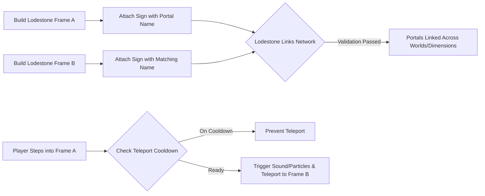

# Lodestone Links

Paper plugin for craftable linked lodestone portals in Minecraft.

## Quick start

1. Drop the jar into your server's `plugins/` folder.
2. Restart the server (full restart, not `/reload`). This generates `config.yml` on first load.
3. Verify: run `/lodewarps list` in-game or console. You should see a response, not "Unknown command."

Then to create a portal: build a rectangular lodestone frame with air inside, place a sign on it with a portal name, and build another matching lodestone frame with the same name anywhere else. The two link automatically. Walk through either one to teleport to the other.

## Features

- No commands needed to create or link portals, just lodestone blocks and a named sign
- Portals can link across the Overworld, Nether, and End
- Configurable teleport cooldown per player
- Configurable min/max portal frame dimensions
- Particle and sound effects on teleport (each can be toggled off)
- `/lodewarps list` and `/lodewarps info` to see your portals and their link status

## Architecture & Mechanics

## Commands

| Command | Aliases | Description | Permission |
|---|---|---|---|
| `/lodewarps list` | `/lw`, `/lodewarp` | Lists your portals (or all portals for admins) | `lodestonewarps.list` |
| `/lodewarps info <name>` | | Shows details and link status for a named portal | none |
| `/lodewarps reload` | | Reloads config.yml | `lodestonewarps.admin` |

## Permissions

| Permission | Default | Description |
|---|---|---|
| `lodestonewarps.create` | true | Create lodestone portals |
| `lodestonewarps.use` | true | Use lodestone portals to teleport |
| `lodestonewarps.list` | true | List your own portals |
| `lodestonewarps.admin` | op | Reload config and list all portals server-wide |

## Config

Key options in `config.yml`:

- `min-portal-width` / `min-portal-height` - smallest allowed interior frame size
- `max-portal-width` / `max-portal-height` - largest allowed interior frame size
- `teleport-cooldown` - seconds between portal uses per player, 0 to disable
- `particles-enabled` / `sounds-enabled` - toggle teleport effects
- `allow-cross-dimension` - allow portals to link across Overworld, Nether, and End
- `debug-enabled` - verbose teleport logging
- `messages.*` - all player-facing message strings, with color codes

## Install

### Requirements

- Paper server on Minecraft 1.21. (Get Paper at https://papermc.io/downloads. Works on Paper only, not vanilla or Realms.)
- Java 21. (Check what you have with `java -version`. Get Java 21 from https://adoptium.net.)

### From a release

1. Go to the [v1.0.0 release](https://github.com/KitsuneTech1/LodestoneWarps/releases/tag/v1.0.0) and download `LodestoneWarps-1.0.0.jar`.

### From source

1. Install Java 21 JDK from https://adoptium.net if you don't have one.
2. Clone the repo: `git clone https://github.com/KitsuneTech1/LodestoneWarps.git`. Or download the ZIP and extract it.
3. Open a terminal in the repository directory and run `mvn clean package`.
4. The jar will be at `target/LodestoneWarps-1.0.0.jar`.

### Troubleshooting

- `UnsupportedClassVersionError` in the console: your server is running an older Java. Install Java 21 and make sure your server startup script points to it.
- Plugin doesn't load or warns about unsupported API version: your server isn't on Minecraft 1.21. Update to a current Paper 1.21 build.
- Portals don't link: both frames need the same sign name, matching interior dimensions within your `config.yml` min/max, and `allow-cross-dimension: true` if in different worlds.

## License

MIT. Copyright (c) 2026 Kitsune Technologies LLC. Do what you like with it, commercially or otherwise, just keep the copyright notice. Full text in [LICENSE](LICENSE).

---

Part of <b>Buildtober 2026</b>: 31 open source projects in 31 days. Built by <a href="https://kitsunetechnologies.org/work">Kitsune Technologies</a>. More at <a href="https://github.com/KitsuneTech1">github.com/KitsuneTech1</a>.

